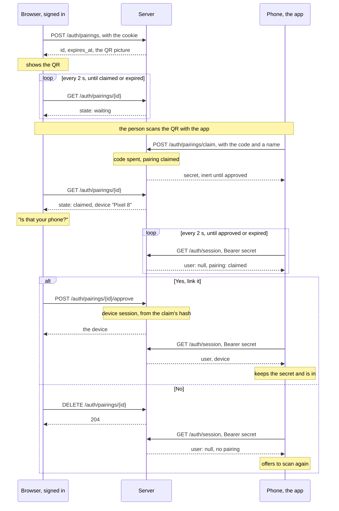

# Device pairing

How a phone gets in, and how its access is listed and ended. The Android
application is the first phone. Everything here is served by the web shell
over the credentials port (`web.md`, `docs/specs/sign-in.md`).

The idea is the one WhatsApp and Telegram use to link a device. One device
shows a QR code. The other device scans it. The one that is signed in
consents. The new device is then listed, and can be removed at any time.

In those products the phone is the signed-in side. Here it is the browser.
The account lives with the company's identity provider, and a browser is
what signs in with it. So the browser shows the code, the phone scans it,
and the browser confirms. The code also names the server. Every company
runs its own Robinauts, so the app learns where to connect from the code,
and nobody types a server address into a phone.

## A device

- A device holds a **device session**: a random 256-bit secret, sent as
  `Authorization: Bearer`. The database holds its SHA-256, never the
  secret, as it does for a browser session and an API token.
- A device session belongs to one user. It records the name the device
  gave itself ("Pixel 8"), its platform, the application's version, when
  it was linked, when it was last used, and when it expires.
- It lives `device_days`, 30 by default. It is not renewed. A phone that
  reaches the end pairs again.
- It ends when its owner removes it under "Linked devices", when the phone
  signs out, when it expires, when the operator clears it, or with the
  user.
- It is not an API token. A token is for a script. A person names it, it
  lasts ninety days, and it is never shown as a device. The two are
  separate tables with one shape. "Linked devices" shows both.
- A secret names its kind. A device session's secret starts with `rbd_`.
  An API token's starts with `rbt_`. The prefix picks the table a bearer is
  looked up in, and lets a secret scanner recognise ours. A secret with no
  prefix is an older API token, and works until it expires.
- In the local development mode a device is linked to the mode's one user,
  as a token is minted for it. Like a session or a token that names that
  user, it signs nobody in where sign-in is on.

## The flow

Three secrets take part. Each does one thing. The **pairing code** is in
the QR. The **claim secret** is what the phone gets for presenting the
code. The **device secret** is what the phone keeps. The device secret is
the claim secret, promoted when the browser approves. So no secret is ever
stored in the clear, and nothing is handed over after the approval.

1. **The browser asks for a code.** `POST /auth/pairings`, with the session
   cookie. The server mints a pairing: an id, a 256-bit code, two minutes
   of life, owned by the signed-in user. It answers the id, the expiry and
   the QR picture. It never answers the code. The picture is all the
   browser needs, and its script has no business with the secret.
2. **The browser shows the QR.** It polls `GET /auth/pairings/{id}` every
   two seconds. Under the picture it says: "Scan this with the Robinauts
   app on your phone. Anyone who scans it can ask to be linked. You will
   be asked to confirm."
3. **The phone scans it.** The code is a URL of the deployment:

       {public_url}/#/link?v=1&c=<code>

   The app takes the origin as the server to talk to, and `c` as the code.
   It accepts `https` only. Development builds also accept `http` on a
   loopback or private address. A plain camera app opens the URL in a
   browser. The interface's `#/link` route then says the code is for the
   app on a phone, and does not use it. The code is in the fragment, so a
   browser does not send it, and no server or proxy logs it.
4. **The phone presents it.** `POST /auth/pairings/claim`, with no
   credential. The body is `{"code": …, "device": {"name": …,
   "platform": …, "app_version": …}}`. In one statement the server finds
   the pairing by the code's hash, requires it to be `waiting` and not
   expired, records the device's description, mints a claim secret, stores
   its hash, and moves the pairing to `claimed`. It answers
   `{"secret": "rbd_…", "expires_at": …}`. A code that is unknown, spent
   or expired is 404. The three cases get the same 404.
5. **The browser asks the person.** Its poll now says `claimed`, with the
   device's description. It asks: "A device calling itself *Pixel 8*
   scanned your code. Is that your phone?" The name is shown as text, like
   every string from outside. **Yes** is `POST /auth/pairings/{id}/approve`.
   **No** is `DELETE /auth/pairings/{id}`. Both are cookie writes, and
   carry `Origin` like every cookie write.
6. **On approval** the server, in one statement, inserts a device session
   whose `secret_hash` is the pairing's claim hash, with `device_days` of
   life, and marks the pairing `approved`. The browser's poll says so, and
   the device appears in the list. On refusal the pairing is deleted. The
   claim secret then resolves to nothing, ever.
7. **The phone waits.** It polls `GET /auth/session` with
   `Authorization: Bearer <secret>` every two seconds, until the pairing's
   expiry. That route is never a 401. While the pairing is `claimed`, it
   answers `user: null` and `pairing: {"state": "claimed"}`. Once approved,
   it answers the user and the device. The phone keeps the secret and is
   in. A pairing that is gone, refused or expired, answers `user: null` and
   no `pairing`. The phone says so and offers to scan again.

The code is spent by the first phone that presents it. A second phone with
a photograph of it gets the 404 of step 4. A first phone that is not the
person's is refused at step 5, and got nothing it can use. In both cases
nothing was issued without the person saying yes.

## Bounds

- A pairing lives **two minutes**. When one expires unclaimed, the browser
  asks for a fresh one, five times. After that it shows a button for the
  next. Telegram rotates every thirty seconds and WhatsApp every twenty.
  Those numbers suit a service with a billion phones. Two minutes is enough
  to find one's phone, and short enough not to matter.
- **Three pairings per user at once.** A fourth is 429, `busy`. Asking for
  one deletes the user's expired ones in the same statement, as beginning
  a sign-in deletes expired pending logins. The table holds minutes and
  needs no sweep.
- An approved pairing stays, as `approved`, until it expires. Both sides'
  polls can read the outcome. It grants nothing after the approval. From
  then on the device session is what resolves.
- `device.name` is at most 64 characters of printable text. `platform` is
  one of `android`, `ios`, `desktop`, `other`. `app_version` is at most 32
  characters. Anything else is 422.
- The claim is the one write a stranger can make. The code is 256 bits, so
  nobody guesses one. A claim creates nothing. At worst a stranger with a
  photograph spends a code, and the person sees it spent. Volume is the
  job of a rate limit in front of the deployment, the operator's reverse
  proxy, as for sign-in.

## Routes

| route | who | purpose |
|---|---|---|
| `POST /auth/pairings` | cookie | mint; answers `{id, expires_at, qr_svg}`; 429 `busy` over the cap; 403 where `device_days` is 0 |
| `GET /auth/pairings/{id}` | cookie, owner | `{state, expires_at, device}`; 404 for another's, or one gone |
| `POST /auth/pairings/{id}/approve` | cookie, owner | link the device; answers it; 409 unless `claimed` |
| `DELETE /auth/pairings/{id}` | cookie, owner | refuse, or cancel; 204 |
| `POST /auth/pairings/claim` | nobody | present a code; answers `{secret, expires_at}`; 404 |
| `GET /auth/session` | bearer | also answers `device`, `token` or `pairing`; never a 401 |
| `GET /auth/devices` | cookie or bearer | the person's devices, oldest first |
| `DELETE /auth/devices/{device_id}` | cookie or bearer | remove one of theirs; 404 for another's |
| `POST /auth/logout` | device bearer | end this device, as it ends a browser's session |

`GET /auth/session` answers for a bearer as it does for a cookie. For a
device session it answers the user and
`device: {id, name, platform, created_at, last_used_at, expires_at}`. For
an API token it answers the user and `token: {id, name, expires_at}`. For
the bearer of a claimed pairing it answers `user: null` and
`pairing: {state: "claimed"}`. For a bearer nobody knows it answers
`user: null`, as for no cookie. The web ignores the new fields.

The QR picture is rendered by the backend as SVG, with `segno`
(BSD-3-Clause, pure Python, no dependencies). It travels in the mint
answer. The browser shows it as ``.
The Content-Security-Policy's `img-src 'self' data:` allows that. It is
never put in the page as markup. The frontend carries no QR library. The
code never reaches the browser's script.

## Records

Two tables, kept through the credentials port like the other three
(`data-model.md`). They are in `schema.sql`, with its pin.

    device_sessions
        id uuid primary key
        user_id uuid not null references users on delete cascade
        name text not null
        platform text not null
        app_version text
        secret_hash text not null unique, a 64-hex check
        created_at, last_used_at, expires_at timestamptz not null
        index (user_id); index (expires_at)

    pairings
        id uuid primary key
        user_id uuid not null references users on delete cascade
        code_hash text not null unique, a 64-hex check
        claim_hash text unique, a 64-hex check    -- set by the claim
        state text not null, one of waiting, claimed, approved
        device_name, device_platform, device_app_version text
        created_at, expires_at timestamptz not null
        index (user_id); index (expires_at)

`last_used_at` is written by the resolve that finds the device, at most
once a minute per device, in the same statement: an `UPDATE … RETURNING`
joined to `users`. The list says "last used" without a write on every
request.

The credentials port has one operation per step: `add_pairing`,
`claim_pairing`, `pairing_of(user_id, pairing_id)`, `approve_pairing`,
`delete_pairing`, `resolve_claim`, `add_device_session`,
`resolve_device_session`, `device_sessions_of`, `delete_device_session`.
Each is one statement. Each is given `now`. Each has its row in the
contract suite, which the memory and the PostgreSQL adapters both pass.
The flow lives in `web/pairing.py`, beside `web/sign_in.py`, with the same
`now` discipline.

## Configuration

    device_days = 30

One key of sign-in's, beside `session_hours`. `0` means no devices: the
pairing routes answer 403, and "Linked devices" shows tokens alone. That is
for a deployment whose policy allows no phones. Absent, it is 30. A file
that names it is a sign-in configuration. The local development mode
refuses it, like the other sign-in keys, and runs on the default.

## The interface

- **"Linked devices"** is a page of the shell at `#/devices`. The profile
  block at the bottom of the panel links to it, beside sign-out. It lists
  the person's devices: name, platform, linked on, last used, expires. Each
  has **Remove**. Below them it lists their API tokens, each with
  **Revoke**. Nothing of the chat library is involved. The panel and the
  shell are ours.
- **"Link a phone"** opens a dialog. It asks for a code and shows the QR,
  with the sentence of step 2. The state is written under it: *waiting*;
  *a device calling itself … scanned your code, is that your phone?* with
  **Yes, link it** and **No**; *linked*; *the code expired* with **Show a
  new code**. Polling runs while the dialog is open. It stops when the
  dialog closes or the tab is hidden. Closing the dialog while a code waits
  deletes the pairing.
- **`#/link`** explains and does nothing: "This code is for the Robinauts
  app on a phone. Open the app and scan it there." It reads no parameter.
- The QR has alternative text. Every state is said in words. No colour
  carries meaning. The picture comes from the server, and the polling is
  `fetch` on a timer through the typed client. Nothing new is installed.
- The session store, `src/session/session.ts`, is unchanged.
  `/auth/session` gains fields the web does not read.

## The Android application

The app is a repository of its own. This is what it does against the API.

- **One origin, from the code.** The app has no server address until it
  scans one. It talks to that origin alone. Release builds speak `https`
  only.
- **Headers.** `Authorization: Bearer rbd_…` on every call.
  `Accept: application/json`. `Content-Type: application/json` on every
  write, with a body or without. That is the rule of
  `docs/specs/sign-in.md`, and what the web's client sends. No cookies and
  no `Origin`: a bearer write is not subject to the origin check.
- **Start-up.** `GET /auth/session`. With a user, the app carries on. With
  none, the device was removed or expired. The app forgets the secret and
  shows the pairing screen. Any `401` later means the same.
- **The secret** lives in storage the operating system keeps for the app
  alone, under a key the Android Keystore holds. It is excluded from
  backups. A backup restored on another phone would otherwise clone the
  device, and the list would show one device that is two.
- **Streams.** A turn's answer is server-sent events, over the same bearer.
  The app reads them with an HTTP client that streams the body, OkHttp or
  Ktor. There is no `EventSource` on a phone, and none is needed, since a
  header can be set. The turn runs on the server whatever happens to the
  stream. An app sent to the background, or a network that changes, loses
  nothing. It re-attaches with `Last-Event-ID`, using the ids and the two
  `X-Robinauts-*` headers of `docs/specs/wire.md`. A comment goes out every
  fifteen seconds while nothing else does.
- **The contract** is `backend/openapi.json`. A Kotlin client is generated
  from it with openapi-generator (Apache-2.0), or written by hand. The
  streaming routes are outside the document, and are in
  `docs/specs/wire.md`.
- **Scanning** is ZXing (Apache-2.0) over CameraX (Apache-2.0). Not ML Kit:
  it is proprietary, it downloads models, and it reports to Google. The
  dependency rules and goal 3 both refuse that. The app has the same
  licence gate as the backend and the frontend, from its first commit.
- **Push notifications** are not part of this. Firebase Cloud Messaging
  sends through Google. That is a decision against "nothing phones home",
  to take on its own, if ever.

## What it defends against

- **A photographed or shared code.** The first claim spends it. It lives
  two minutes. Nothing is issued until the person approves a device they
  recognise.
- **A stranger's code shown to the person.** That is the attack of the
  other direction: a victim scans an attacker's code and signs the attacker
  in. It cannot happen here. Scanning gives the one who showed the code
  nothing. The scanner receives, and only after the one who showed the
  code approves.
- **Two claims racing.** One statement moves `waiting` to `claimed`. The
  second finds it moved.
- **Secrets at rest.** Hashes only, in every table. The claim secret
  becomes the device's, so no secret waits in the clear to be collected.
- **Secrets in logs.** The code travels in a fragment and a JSON body,
  never in a path or a query. The secret travels in a bearer, which is
  never logged.
- **Cross-site requests.** Cookie writes carry `Origin`. The claim has no
  cookie. A bearer write is exempt, as today, and a browser cannot send a
  bearer it does not hold.
- **The device's name.** Text the phone chose, bounded and shown as data.
- **A code on a shared screen.** The sentence under the QR says what a scan
  can do. The approval is the control.

## Known limits

- **A device outlives the sign-in that made it.** A browser session lasts
  twelve hours. A device lasts `device_days`. The allow list is checked at
  sign-in only, so a person removed at the identity provider keeps their
  phone for up to `device_days`. The operator's control is `device_days`.
  The person's is the list.
- **A person with only their phone cannot pair.** Pairing needs a second
  screen. The browser hand-off is not here yet: the app opens the system
  browser on `/auth/login/{provider}`, the callback redirects to the app
  with a one-time code, and the app exchanges it for a device session. It
  ends in the same table and the same list.
- **The other direction is not here yet.** A browser signed in by scanning
  with a phone, for a shared screen or a kiosk, is the same pairing record
  with the roles swapped, plus a confirmation screen on the phone.
- **No typed code.** Where no camera can see the screen, there is no way
  to pair. A short code needs a rate limit, and is not here.
- **No operator's view.** Every device of every user, and "remove all of a
  person's", come with the admin screens (`docs/specs/privacy.md`).
- **No audit entries yet.** Device linked, device removed and pairing
  refused are log lines, as sign-ins are, until the audit log exists.
