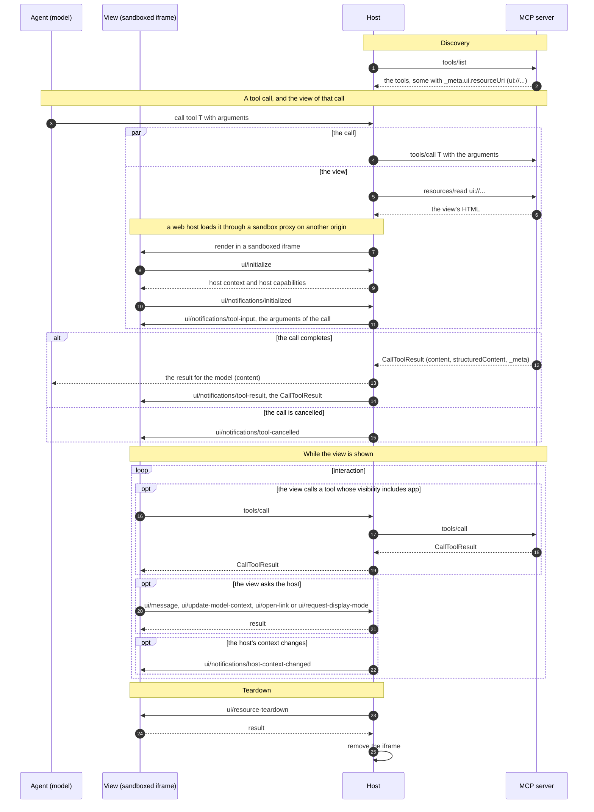

# MCP Apps

MCP Apps is the extension `io.modelcontextprotocol/ui` of MCP (SEP-1865). Robinauts follows its
version `2026-01-26`.

A tool server ships a small interface with a tool. The tool names a `ui://` resource in
`_meta.ui.resourceUri`. The resource is one HTML document of type `text/html;profile=mcp-app`:
the **view**. A **host** shows the view in a sandboxed frame and talks to it over `postMessage`,
in JSON-RPC.

Robinauts is a host. Its views show in the side panel beside the chat.

## The standard

## Who does what

- **The server** is a tool server the operator configured (`[tool_servers.<id>]`).
- **The engine** makes the agent's tool calls (steps 3, 4, 12 and 13), with the framework's own
  MCP client.
- **Web** reads the view from the server (steps 5 and 6) and relays the view's tool calls (steps
  17 and 18), with a small MCP client of its own on httpx (`web/mcp_client.py`).
- **The panel** frames the view and speaks the protocol with it (steps 7 to 11, 14 to 16 and 19
  to 25): `frontend/src/side/`.
- **The view** is third-party code in the person's browser. It talks to the panel alone.

## Tabs and sub-tabs

- **A tab is one view of one server.** Its title is the view's `title` in the server's resource
  list, or its `name`. A server that does not list the view gives the title of the first tool
  that names it.
- **A sub-tab is one call of the agent**: a tool with that view, and its arguments. Its name is
  the tool's title and a number, `Diagram 1`.
- **A call with the same tool and arguments uses the sub-tab of the earlier call.** The view
  there is sent the new result.
- **The agent's call opens the tab and selects the sub-tab.** A collapsed panel stays collapsed.
- **"Add a tab" lists the agent's views.** A tab added by hand is empty until the conversation
  has a call for it.
- **Sub-tabs come from the transcript**: the tool calls of the thread on the screen. A reopened
  conversation shows them again, on any device. Open tabs are remembered per conversation, per
  browser.
- **A sub-tab loads its frame when it is first selected.** The frame then stays in the page while
  the tab is open, hidden when another is on top.

## What a view is told

| Step | Message | What the panel sends |
|---|---|---|
| 9 | answer to `ui/initialize` | `protocolVersion` `2026-01-26`; `hostCapabilities.serverTools`; `hostContext` with `theme`, `displayMode` `inline`, `availableDisplayModes` `["inline"]` and a fixed `containerDimensions` |
| 11 | `ui/notifications/tool-input` | the arguments of the agent's call, from the transcript |
| 14 | `ui/notifications/tool-result` | the result of the agent's call: `content` with one text block, `structuredContent` and `isError` |
| 15 | `ui/notifications/tool-cancelled` | sent when the turn ended and the call has no result |
| 22 | `ui/notifications/host-context-changed` | the new `theme`, or the new `containerDimensions` |
| 23 | `ui/resource-teardown` | sent before the frame is removed; the panel does not wait for the answer |

- The side panel is reported as `inline`. A view fills the box of its `containerDimensions`.
- A frame that is not on the screen has no size. Its `containerDimensions` come later, in
  `host-context-changed`.
- The text block holds the text the model read.
- The panel sends a view nothing before `ui/notifications/initialized`.
- A cancelled call leaves its view in place.

## What a view may ask

- **`tools/call`** is relayed to the view's own server
  (`POST /robinauts/api/apps/<server>/tools/<tool>`). The tool must be one the agent is given,
  with `app` in `_meta.ui.visibility`. A view may call a tool as soon as it runs. A call the
  backend refuses is answered with a JSON-RPC error.
- **`ping`** is answered.
- **Every other request is answered "method not found"**: `ui/open-link`, `ui/message`,
  `ui/update-model-context`, `ui/request-display-mode`, `resources/read`.
- **A view keeps its data fresh by polling**, the standard's pattern: it calls an `app` tool
  again every few seconds. A view polls only while it is drawn. The example views ask the browser
  for an animation frame before each read. The panel hides a frame with `display: none`, and
  the browser gives such a frame none.
- **A result told later may be older than what the view read itself.** The view keeps the newer
  of the two.

## How the result reaches the view

The engine receives the server's answer (step 12). The model reads its text. The view needs its
structured content.

1. **The engine reports both.** A tool result has the text for the model and the server's
   structured content, apart ([agent-engines.md](../specs/agent-engines.md)).
2. **The transcript keeps both.** The `tool_result` part has an optional `structured` field
   ([data-model.md](data-model.md)).
3. **The panel asks for one call's result**:
   `GET /robinauts/api/conversations/<id>/messages/<message>/tool-result?call_id=<call>`
   ([web.md](web.md)). The chat's stream carries the text alone.

Every tool call is the agent's or a view's. The panel makes none of its own.

## Isolation

The view runs next to a page that holds a signed-in person's session.

- **The backend serves the view from its own origin**, at
  `/robinauts/api/apps/<server>/<tool>/view`, under a policy of the view's own:
  `default-src 'none'; script-src 'unsafe-inline'; style-src 'unsafe-inline'; img-src data:;
  font-src data:; connect-src 'none'; base-uri 'none'; form-action 'none';
  frame-ancestors 'self'; sandbox allow-scripts`, with `X-Frame-Options: SAMEORIGIN` and
  `Cache-Control: no-store`. The policy is in `web/apps.py`, and a test holds it to its text.
- **The panel frames the view with `sandbox="allow-scripts"` alone.** The view gets an opaque
  origin, even opened as a page of its own. It cannot read the session, call the API or script
  the interface.
- **The interface's own policy gains `frame-src 'self'` and nothing else.** A `srcdoc` or a
  `blob:` URL would make that policy allow inline script or `blob:` for the page that holds the
  session.
- **The panel reads a message only from its frame's window.** An opaque origin has no name, so
  the panel posts to `"*"`. It sends what the view's own server already has: the theme, the size,
  the arguments of the agent's call and the server's answers. A tool call the backend refuses is
  answered with fixed words, whatever the backend said.
- **The server's credential stays on the backend.** The browser never reaches a tool server.
- **A server that cannot be reached is left out of the list**, and logged by its id and the kind
  of failure.

## Where Robinauts differs from the standard

- **No sandbox proxy.** The standard asks a web host for a proxy frame on another origin. A
  second origin needs a second host name and certificate in every deployment. The sandboxed
  frame gives the view an origin of its own without one.
- **No remote origins and no permissions.** What a view asks for in `_meta.ui.csp` and
  `_meta.ui.permissions` is not given: nothing phones home.
- **One place, one mode.** Views show in the side panel alone, reported as `inline`. A tool call
  in the chat shows no view.
- **A repeated call reuses its view.** The standard gives each call a view of its own.
- **A result is text and structured content.** Its other content blocks and its `_meta` are not
  kept. Structured content above 1 MiB is not kept either, and the view is then sent the text
  alone.
- **`hostContext.toolInfo` is not sent.**
- **Each request to a server opens an MCP session and ends it.** A view that polls costs four
  requests to its server per read.
- **The engines do not read `_meta.ui.visibility`.** A tool with `app` alone is still given to
  the model, unless the server's `exclude` names it, which hides it from views too.
- **Robinauts does not advertise the extension** in its clients' capabilities. A server that
  registers its views only for hosts that do offers Robinauts none.
