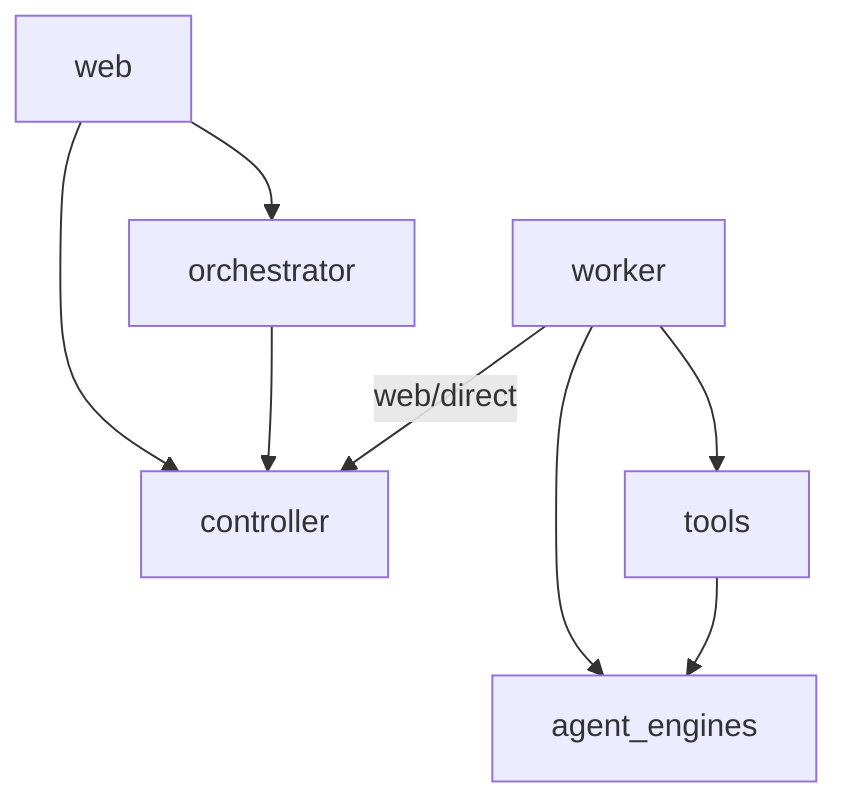

# Layer references rules

Anything not allowed is forbidden. A rule names a package and covers everything
under it. `backend/pyproject.toml` enforces these; `tests/tooling/test_architecture.py`
runs them.

## Top level

shared_domain -> nothing from robinauts; any package but agent_engines may import it
agent_engines -> nothing from robinauts
tools -> agent_engines.contract
controller -> shared_domain; nothing of the orchestrator
orchestrator -> shared_domain, controller.contract
worker -> controller.contract.broker, web.contract.broker, agent_engines.contract, tools.contract
web -> controller.contract, orchestrator.contract
cli -> web, controller, orchestrator, worker, tools, agent_engines.contract, all but web, controller.contract and orchestrator.contract by cli.composition alone; imported by nothing

## Inside agent_engines

contract -> nothing from robinauts
echo_engine -> contract
langchain_engine -> contract + langchain deps + postgres
pydantic_ai_engine -> contract + pydantic ai deps + postgres
no engine imports another

## Inside tools

contract -> agent_engines.contract
each tool (sessions) -> contract, agent_engines.contract
no tool imports another; only cli.composition imports a tool

## Inside controller

contract -> nothing from robinauts
contract.broker -> contract; contract never imports contract.broker
ports -> contract
core -> contract, ports; pure functions, no I/O
adapters -> contract, ports
application -> contract, ports, core

## Inside orchestrator

contract -> nothing from robinauts
ports -> contract
core -> contract, ports, controller.contract, shared_domain; pure functions, no I/O
adapters -> contract, ports, controller.contract, shared_domain
adapters.neorc -> the one place neorc is imported
application -> contract, ports, core, controller.contract, shared_domain

## Inside web

contract -> controller.contract; nothing else of web

## Third-party libraries, where each may be imported

langchain, langchain_core, langchain_*, langgraph, langchain_mcp_adapters, langsmith -> langchain_engine
pydantic_ai, pydantic_graph, fastmcp, logfire, logfire_api, opentelemetry -> pydantic_ai_engine
anthropic, openai, mcp -> langchain_engine, pydantic_ai_engine
asyncpg, sqlite3, aiosqlite -> langchain_engine, pydantic_ai_engine, controller.adapters
httpx -> web, worker.http_turn_broker, langchain_engine, pydantic_ai_engine
fastapi -> web, cli
starlette, ag_ui -> web
uvicorn -> cli
neorc, neorc_core, neorc_ui -> orchestrator.adapters.neorc
qrcodegen -> web
